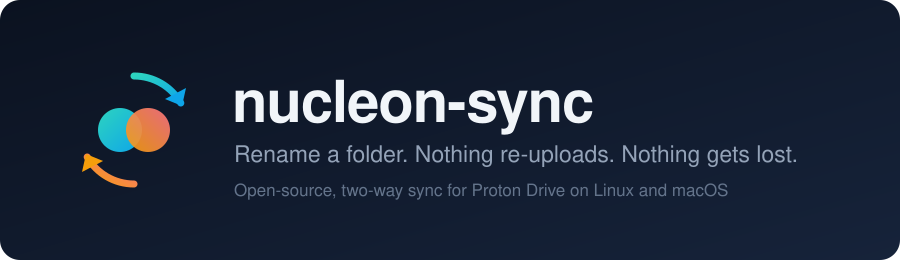
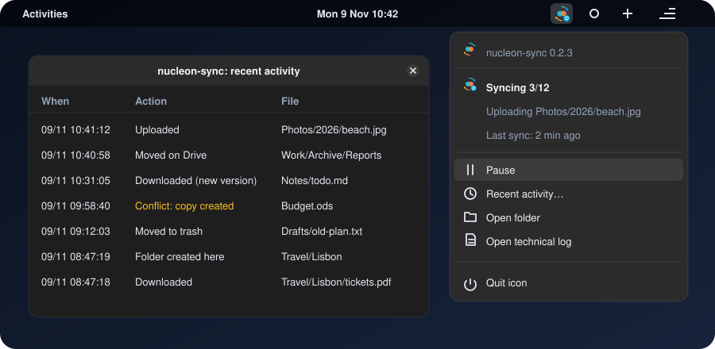

<p align="center">
  
</p>

<p align="center">
  <a href="https://github.com/steph-ben/nucleon-sync/releases"></a>
  <a href="https://github.com/steph-ben/nucleon-sync/actions/workflows/ci.yml"></a>
  <a href="LICENSE"></a>
  
</p>

**Open-source, two-way sync for Proton Drive on Linux and macOS.** It keeps a folder on your computer and your Drive identical, in the background, and keeps your files safe when something goes wrong.

- **Works like a normal sync folder.** Edit, add, move or delete files in `~/Proton`, on any machine. The other side follows by itself.
- **Rename a whole folder in one go.** A rename or a move is sent as a rename, not as a delete plus a new upload.
- **Never loses a file.** Deletions go to the Proton trash or to a local quarantine, conflicts keep both versions, and a large batch of deletions waits for your OK.
- **Shows what it does.** An icon in the top bar tells you if all is in sync, and desktop notifications tell you when something needs you.
- **End-to-end encrypted, the Proton way.** Proton's own SDK encrypts your files before they leave your computer. Your password never reaches nucleon-sync.

<p align="center">
  
</p>

The tray icon on Linux. Its badge shows the state: up to date, syncing, paused, or action needed. The menu lets you pause, approve held deletions, open the folder, and see recent activity: what was uploaded, downloaded, moved or put aside, and when.

## Install

```sh
curl -fsSL https://steph-ben.github.io/nucleon-sync/install.sh | sh
```

One command, no `sudo`, nothing to prepare. It installs under `~/.local`, then starts a short setup: choose a folder, sign in on Proton's own page, see what the first sync would do, and say yes. Full details are in `install/install.sh`, a short script you can read first.

> [!IMPORTANT]
> **Beta, unofficial, not affiliated with Proton.** This is a third-party application not officially supported by Proton. Proton is a trademark of Proton AG. Sync is not a backup: keep a separate copy of what you care about.

## How it works

```text
 YOUR COMPUTER                                                     PROTON
┌───────────────────────────────────────────────────────┐
│  ~/Proton              your files, plain files        │
│      ▲                                                │
│      │ watches, reads, writes                         │
│      ▼                                                │
│  nucleon-sync          background service             │
│      │  ├─ state.sqlite   what was last in sync       │
│      │  └─ quarantine/    what sync replaced here     │
│      ▼                                                │
│  Proton Drive SDK      Proton's own open-source code  │      ┌────────────┐
│      │                 encrypts before anything       │ ───▶ │ Your Drive │
│      │                 leaves your computer           │ ◀─── │ encrypted  │
│      └─ session in your system keyring                │ TLS  └────────────┘
└───────────────────────────────────────────────────────┘
```

- **Proton's own library does the sensitive work.** Every Drive operation, encryption included, goes through the [Proton Drive SDK](https://github.com/ProtonDriveApps/sdk). nucleon-sync has no crypto of its own and never calls Proton's servers directly. It is not the official client, and it says so to Proton: `external-drive-nucleon_sync`.
- **Your password never reaches it.** You sign in on Proton's web page. Only the session is kept, in your system keyring.
- **No telemetry.** Your files and their names go only to Proton. The one other connection is a check for new versions on GitHub.
- **The database holds no file content.** `state.sqlite` keeps names, paths, hashes, sizes and dates, unencrypted, in `~/.local/share/nucleon-sync`. It is how a rename is told from a delete plus a new file. Lose it and the next run matches your files again by content, deleting nothing.

## What gets installed

| What | Where |
| --- | --- |
| The command | `~/.local/bin/nucleon-sync` |
| The program, with its own bun runtime (about 80 MB) | `~/.local/share/nucleon-sync/app` |
| Configuration, database, log, quarantine | `~/.local/share/nucleon-sync` |
| The background service | systemd on Linux, launchd on macOS, in your user account |
| The tray icon, on Linux | `~/.config/autostart`, if your desktop has the library it needs |
| The menu bar icon, on macOS | `~/.local/bin/nucleon-sync-tray` and a launchd agent, built on your Mac with `swiftc` |
| Your Proton session | your system keyring |

`nucleon-sync uninstall` removes the command, the program, the service and the tray icon. Your data and sign-in stay unless you add `--purge-data`. It never touches the synced folder.

## How your files are protected

Nothing is deleted permanently. The code cannot empty the Proton trash, and a test checks it has no way to.

A file you delete on your computer goes to the Proton trash, which you can restore from the web. A file deleted or replaced on the Drive is kept in `~/.local/share/nucleon-sync/quarantine` before it is removed or overwritten on your computer.

| If this happens | nucleon-sync does this |
| --- | --- |
| You and another machine edit the same file | Both versions are kept |
| The folder looks empty (disk not mounted, for example) | It stops, and nothing is deleted |
| More than 20 deletions at once | It waits for `nucleon-sync approve` |
| A file cannot be read | It is left alone, on both sides |
| The configuration points at another Drive target | It stops before planning anything |
| The computer crashes in the middle of a sync | It resumes without losing or duplicating anything |

Each of these has automated tests: about 220 everyday and failure scenarios ([the list](docs/test-catalog.md)), a crash test at every single step, and random simulations of two machines. `DriveApi` in `src/adapters/proton.ts` exposes no permanent deletion.

## Daily use

The sync runs by itself and starts at login. On Linux, the tray icon covers the everyday needs. The same things, and a few more, are in the terminal:

    nucleon-sync status                  where things stand
    nucleon-sync activity                what really happened to your files
    nucleon-sync pause / resume          stop and restart
    nucleon-sync exclude add '*.tmp'     keep matching names out (exclude list, exclude remove)
    nucleon-sync approve                 accept a large batch of deletions that was held back
    nucleon-sync update                  install the latest release, and go back if it fails
    nucleon-sync uninstall               remove the program

`nucleon-sync uninstall` keeps your data folder (`~/.local/share/nucleon-sync`) unless you add `--purge-data`, which also deletes the quarantine and your saved sign-in.

To change the folder or the target, stop the service and run `nucleon-sync setup --reset`: it moves the configuration and the database aside, deletes nothing, then runs the setup again. To try it on a throwaway space first, run `nucleon-sync setup --test-space` with a small folder.

## Status and limits

This is beta software. The author uses it daily on a real Drive. The whole install chain has been tried on Linux; on macOS, parts of it are covered by tests only. Supported systems: Linux x64 and macOS Intel. Apple Silicon and Windows are not supported yet.

The Proton Drive SDK is meant for personal, non-commercial use for now, and Proton says it is not ready yet for third-party apps in production. Proton plans new cryptography around the end of 2026 or early 2027, and nucleon-sync will need an update by then. It tells you when that happens.

On Linux you need a running keyring (libsecret, for example gnome-keyring). The tray icon needs `libayatana-appindicator-gtk3` or `libappindicator-gtk3`, and on GNOME the AppIndicator extension. 

Do not run another sync tool on the same folder. Native Proton Docs and Sheets are never synced.

## Troubleshooting

The log is `~/.local/share/nucleon-sync/nucleon-sync.log`, one line per event, and no warnings or errors in the log means all is well. The service output is in `journalctl --user -u nucleon-sync` on Linux and `~/Library/Logs/nucleon-sync.log` on macOS.

## Development

    npm install --ignore-scripts
    bash scripts/patch-crypto.sh
    scripts/test-all.sh

The tests need no Proton account. Design notes are in `docs/design.md`.

## License

MIT, see `LICENSE`. Bundled libraries are listed in `THIRD-PARTY-NOTICES` in each release.

Made by [steph-ben](https://github.com/steph-ben).

On macOS the menu bar icon is built on your Mac by `setup`, with the Apple command line tools (`xcode-select --install` if they are missing).
